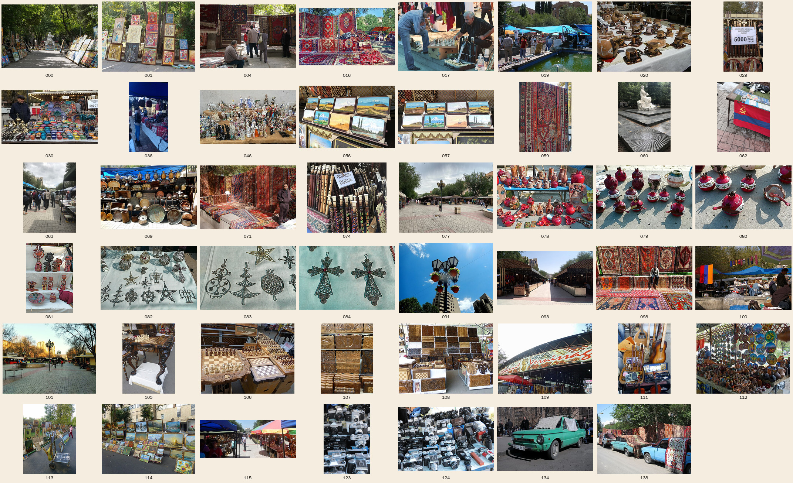

# Фото Вернисажа — свободные лицензии (Wikimedia Commons)

Найдено **139 фото** в категории [Category:Yerevan Vernissage](https://commons.wikimedia.org/wiki/Category:Yerevan_Vernissage) и поиске Commons. Все под свободными лицензиями: CC0 — 14, CC BY — 17, CC BY‑SA — 108.
Под сценарий ([`script.md`](script.md)) отобрано **47 кадров** — ниже по сценам. Полный список с авторами и ссылками — [`photos_all.csv`](photos_all.csv) (колонка `selected = yes` — отобранные).



## Как скачать оригиналы

```bash
cd vernissage
python3 download_photos.py        # 47 отобранных
python3 download_photos.py --all  # все 139
```

Файлы лягут в `vernissage/photos/` (в git не попадают — оригиналы весят 2–8 МБ каждый).

## Правила использования в YouTube

| Лицензия | Что нужно |
|---|---|
| **CC0** | Ничего. Можно без подписи (но подпись — хороший тон) |
| **CC BY** | Указать автора, лицензию и ссылку — в описании видео |
| **CC BY‑SA** | То же + «на тех же условиях». Если вы **меняете** само фото (ретушь, вырезка слоёв для параллакса), изменённое фото формально тоже под CC BY‑SA. Ролик целиком закрывать этим не принято, но безопаснее всего для героев кадра брать CC0 / CC BY |

- Готовый текст для описания видео — в конце этого файла.
- Люди в кадре: для рекламного использования нужно их согласие; для познавательного ролика обычно достаточно лицензии фото, но крупные лица лучше не делать «лицом» превью.
- ⚠️ Кадры с пометкой «мало для 1080p» используйте как вставку (рамка‑полароид, коллаж), а не на весь экран.

## Пробелы — чего на Commons нет

- **Обсидиан** крупно — нет ни одного кадра. Сцену 13 можно сделать про серебро/филигрань (кадры есть) или взять обсидиан со стока.
- **Нарды в процессе игры** — есть только игра в **шахматы** (сцена 15). Текст закадра лучше поправить: «играют в шахматы и нарды».
- **Архив 1980‑х** — самые старые кадры 2005–2007 годов. В сцене 5–6 подписывайте реальный год, не выдавайте их за 1980‑е.
- **Видео и дрон** — на Commons нет; пролёты делать 2.5D‑параллаксом из панорамы `Yerevan Vernissage.jpg` или стоком.

Полезный факт из метаданных: фото Armineaghayan подписаны *«after reconstruction», сентябрь 2016* — значит, нынешние павильоны с деревянными навесами появились после реконструкции 2016 года.

## Кадры по сценам

### Сцена 1 · Интро‑нарезка (0:00–0:05)

| Превью | Что в кадре | Автор · лицензия · дата | Размер |
|---|---|---|---|
| [](https://commons.wikimedia.org/wiki/File:Yerevan_Vernissage_carpets.jpg) | **Продавец среди ковров — главный кадр**<br>`Yerevan Vernissage carpets.jpg` | Nicholas Babaian · [CC BY-SA 2.0](https://creativecommons.org/licenses/by-sa/2.0) · 2011-04-23 | 2144×1424 |
| [](https://commons.wikimedia.org/wiki/File:Vernissage,_Erevan,_Arm%C3%A9nie_-_duduk.JPG) | **Табличка «DUDUK»**<br>`Vernissage, Erevan, Arménie - duduk.JPG` | Benoît Prieur · [CC0](http://creativecommons.org/publicdomain/zero/1.0/deed.en) · 2018-10-22 | 3168×2802 |
| [](https://commons.wikimedia.org/wiki/File:Yerevan_-_Armeni%C3%AB_(2926430885).jpg) | **Гранаты‑керамика**<br>`Yerevan - Armenië (2926430885).jpg` | Rita Willaert from 9890 Gavere, Belgium · [CC BY 2.0](https://creativecommons.org/licenses/by/2.0) · 2008-09-06 | 2822×1881 |
| [](https://commons.wikimedia.org/wiki/File:Yerevan_Vernissage-Echiquiers_(1).jpg) | **Резные шахматы**<br>`Yerevan Vernissage-Echiquiers (1).jpg` | Ji-Elle · [CC BY-SA 4.0](https://creativecommons.org/licenses/by-sa/4.0) · 2015-09-26 | 4320×3240 |
| [](https://commons.wikimedia.org/wiki/File:Paintings_of_My_Ararat_at_the_Yerevan_Vernissage.jpg) | **Картины с Араратом**<br>`Paintings of My Ararat at the Yerevan Vernissage.jpg` | Yerevantsi · [CC BY-SA 4.0](https://creativecommons.org/licenses/by-sa/4.0) · 2018-07-11 | 2304×1497 |
| [](https://commons.wikimedia.org/wiki/File:Yerevan_Vernissage09.jpg) | **Советские фотоаппараты**<br>`Yerevan Vernissage09.jpg` | Akitoshi Iio · [CC BY-SA 3.0](https://creativecommons.org/licenses/by-sa/3.0) · 2010-02-20 | 800×531 ⚠️ мало для 1080p |

### Сцена 3 · Пролёт над рядами (0:12–0:20)

| Превью | Что в кадре | Автор · лицензия · дата | Размер |
|---|---|---|---|
| [](https://commons.wikimedia.org/wiki/File:Yerevan_Vernissage-Entr%C3%A9e.jpg) | **Арка‑вход с надписью Vernissage — под титр**<br>`Yerevan Vernissage-Entrée.jpg` | Ji-Elle · [CC BY-SA 4.0](https://creativecommons.org/licenses/by-sa/4.0) · 2015-09-26 | 4320×3240 |
| [](https://commons.wikimedia.org/wiki/File:Yerevan_Vernissage.jpg) | **Широкая панорама — медленный пан**<br>`Yerevan Vernissage.jpg` | Armineaghayan · [CC BY-SA 4.0](https://creativecommons.org/licenses/by-sa/4.0) · 2017-08-06 | 4887×1941 |
| [](https://commons.wikimedia.org/wiki/File:Vernissage,_Yerevan,_July_2023.jpeg) | **Ряды, июль 2023**<br>`Vernissage, Yerevan, July 2023.jpeg` | Textfabrikant · [CC BY-SA 4.0](https://creativecommons.org/licenses/by-sa/4.0) · 2023-07-11 | 4032×3024 |

### Сцена 4 · Слово «вернисаж» (0:20–0:32)

| Превью | Что в кадре | Автор · лицензия · дата | Размер |
|---|---|---|---|
| [](https://commons.wikimedia.org/wiki/File:Yerevan_Vernissage-Vente_de_tableaux_(2).jpg) | **Картины на мостовой**<br>`Yerevan Vernissage-Vente de tableaux (2).jpg` | Ji-Elle · [CC BY-SA 4.0](https://creativecommons.org/licenses/by-sa/4.0) · 2015-09-26 | 4320×3240 |
| [](https://commons.wikimedia.org/wiki/File:Yerevan_Vernissage-Vente_de_tableaux_(1).jpg) | **Тележка с картинами (вертикаль)**<br>`Yerevan Vernissage-Vente de tableaux (1).jpg` | Ji-Elle · [CC BY-SA 4.0](https://creativecommons.org/licenses/by-sa/4.0) · 2015-09-26 | 3240×4320 |

### Сцена 5 · 1980‑е, уличная выставка (0:32–0:45)

| Превью | Что в кадре | Автор · лицензия · дата | Размер |
|---|---|---|---|
| [](https://commons.wikimedia.org/wiki/File:Armenia,_Yerevan_(2166087660).jpg) | **Картины у памятника Сарьяну, 2006 — под «архивный» фильтр, подписать год**<br>`Armenia, Yerevan (2166087660).jpg` | Tamara Areshian from London, UK · [CC BY 2.0](https://creativecommons.org/licenses/by/2.0) · 2006-10-11 | 2560×1920 |

### Сцена 6 · 1988 → 1990‑е (0:45–0:55)

| Превью | Что в кадре | Автор · лицензия · дата | Размер |
|---|---|---|---|
| [](https://commons.wikimedia.org/wiki/File:Erevan_-_Vernissage_01.JPG) | **Вернисаж в 2005**<br>`Erevan - Vernissage 01.JPG` | Antonov14 · [CC BY-SA 3.0](https://creativecommons.org/licenses/by-sa/3.0) · 2005-07 | 1024×768 ⚠️ мало для 1080p |
| [](https://commons.wikimedia.org/wiki/File:Erevan_-_Vernissage_02.JPG) | **Керамика, 2005**<br>`Erevan - Vernissage 02.JPG` | Antonov14 · [CC BY-SA 3.0](https://creativecommons.org/licenses/by-sa/3.0) · 2005-07 | 1024×768 ⚠️ мало для 1080p |
| [](https://commons.wikimedia.org/wiki/File:Yerevan_Vernissage_view.jpg) | **Вид рынка, 2007**<br>`Yerevan Vernissage view.jpg` | Deb Collins · [CC BY 2.0](https://creativecommons.org/licenses/by/2.0) · 2007-10-20 | 3008×2000 |
| [](https://commons.wikimedia.org/wiki/File:Vernissage_market,_Yerevan.jpg) | **Ковры, 2007**<br>`Vernissage market, Yerevan.jpg` | Deb Collins · [CC BY 2.0](https://creativecommons.org/licenses/by/2.0) · 2007-10-20 | 3008×2000 |

### Сцена 7 · Сквер Сарьяна vs ул. Арама (0:55–1:02)

| Превью | Что в кадре | Автор · лицензия · дата | Размер |
|---|---|---|---|
| [](https://commons.wikimedia.org/wiki/File:2025-05-18_Yerevan,_Saryan_park.jpg) | **Аллея художников в сквере Сарьяна, 2025**<br>`2025-05-18 Yerevan, Saryan park.jpg` | Alexkom000 · [CC BY 4.0](https://creativecommons.org/licenses/by/4.0) · Taken on 1 | 5660×3773 |
| [](https://commons.wikimedia.org/wiki/File:Saryan_statue_(Yerevan)_May_2018.jpg) | **Памятник Сарьяну**<br>`Saryan statue (Yerevan) May 2018.jpg` | Benoît Prieur · [CC0](http://creativecommons.org/publicdomain/zero/1.0/deed.en) · 2018-05-12 | 3024×4032 |
| [](https://commons.wikimedia.org/wiki/File:Yerevan_Vernissage_by_ArmAg_(1).jpg) | **Новые павильоны после реконструкции, 2016**<br>`Yerevan Vernissage by ArmAg (1).jpg` | Armineaghayan · [CC BY-SA 4.0](https://creativecommons.org/licenses/by-sa/4.0) · 2016-09-07 | 3872×2176 |

### Сцена 8 · Разделитель «Что здесь искать» (1:02–1:10)

| Превью | Что в кадре | Автор · лицензия · дата | Размер |
|---|---|---|---|
| [](https://commons.wikimedia.org/wiki/File:Yerevan_Vernissage_after_renovation_(5).jpg) | **Фонарь с гранатами на фоне неба**<br>`Yerevan Vernissage after renovation (5).jpg` | Armineaghayan · [CC BY-SA 4.0](https://creativecommons.org/licenses/by-sa/4.0) · 2017-05-31 | 4896×3672 |
| [](https://commons.wikimedia.org/wiki/File:Yerevan_-_Armeni%C3%AB_(2926436649).jpg) | **Филигранные кресты — текстура для орнаментной маски**<br>`Yerevan - Armenië (2926436649).jpg` | Rita Willaert from 9890 Gavere, Belgium · [CC BY 2.0](https://creativecommons.org/licenses/by/2.0) · 2008-09-06 | 2677×1785 |

### Сцена 9 · Ковры (1:10–1:16)

| Превью | Что в кадре | Автор · лицензия · дата | Размер |
|---|---|---|---|
| [](https://commons.wikimedia.org/wiki/File:Armenian_rugs_at_Vernissage_Yerevan.jpg) | **Ковры и продавец**<br>`Armenian rugs at Vernissage Yerevan.jpg` | Deb Collins · [CC BY 2.0](https://creativecommons.org/licenses/by/2.0) · 2007-10-20 | 3008×2000 |
| [](https://commons.wikimedia.org/wiki/File:Carpets_in_Yerevan_vernissage.jpg) | **Ряд ковров**<br>`Carpets in Yerevan vernissage.jpg` | Yervand M. · [CC BY-SA 2.0](https://creativecommons.org/licenses/by-sa/2.0) · 2012-10-13 | 1417×850 ⚠️ мало для 1080p |
| [](https://commons.wikimedia.org/wiki/File:Raffi_kojian-yerevan-_114923074.jpg) | **Килим (вертикаль)**<br>`Raffi kojian-yerevan- 114923074.jpg` | RaffiKojian · [CC BY 4.0](https://creativecommons.org/licenses/by/4.0) · 2022-11-18 | 3000×4000 |
| [](https://commons.wikimedia.org/wiki/File:Yerevan-carpets-vernissage-raffi_kojian.jpg) | **Ковры, наброшенные на старые машины**<br>`Yerevan-carpets-vernissage-raffi kojian.jpg` | User: (WT-shared) Raffikojian at wts wikivoyage · [CC BY 3.0](https://creativecommons.org/licenses/by/3.0) · 24 October | 800×600 ⚠️ мало для 1080p |

### Сцена 10 · Дудук (1:16–1:22)

| Превью | Что в кадре | Автор · лицензия · дата | Размер |
|---|---|---|---|
| [](https://commons.wikimedia.org/wiki/File:Vernissage,_Erevan,_Arm%C3%A9nie_-_duduk.JPG) | **Дудуки с табличкой**<br>`Vernissage, Erevan, Arménie - duduk.JPG` | Benoît Prieur · [CC0](http://creativecommons.org/publicdomain/zero/1.0/deed.en) · 2018-10-22 | 3168×2802 |
| [](https://commons.wikimedia.org/wiki/File:Yerevan_Vernissage-Instruments_de_musique.jpg) | **Музыкальные инструменты**<br>`Yerevan Vernissage-Instruments de musique.jpg` | Ji-Elle · [CC BY-SA 4.0](https://creativecommons.org/licenses/by-sa/4.0) · 2015-09-26 | 3240×4320 |
| [](https://commons.wikimedia.org/wiki/File:Merkato_Vernissage_(Erevano)_05.jpg) | **Дудук за 5000 драм (вертикаль)**<br>`Merkato Vernissage (Erevano) 05.jpg` | RG72 · [CC BY-SA 4.0](https://creativecommons.org/licenses/by-sa/4.0) · 2021-11-27 | 2592×4608 |

### Сцена 11 · Нарды / шахматы → Арарат (1:22–1:28)

| Превью | Что в кадре | Автор · лицензия · дата | Размер |
|---|---|---|---|
| [](https://commons.wikimedia.org/wiki/File:Yerevan_Vernissage-Echiquiers_(3).jpg) | **Нарды и шкатулки**<br>`Yerevan Vernissage-Echiquiers (3).jpg` | Ji-Elle · [CC BY-SA 4.0](https://creativecommons.org/licenses/by-sa/4.0) · 2015-09-26 | 4320×3240 |
| [](https://commons.wikimedia.org/wiki/File:Yerevan_Vernissage-Echiquier.jpg) | **Резной шахматный столик**<br>`Yerevan Vernissage-Echiquier.jpg` | Ji-Elle · [CC BY-SA 4.0](https://creativecommons.org/licenses/by-sa/4.0) · 2015-09-26 | 3240×4320 |
| [](https://commons.wikimedia.org/wiki/File:Paintings_of_My_Ararat_at_the_Yerevan_Vernissage2.jpg) | **Арарат на картинах — переход**<br>`Paintings of My Ararat at the Yerevan Vernissage2.jpg` | Yerevantsi · [CC BY-SA 4.0](https://creativecommons.org/licenses/by-sa/4.0) · 2018-07-11 | 2304×1295 |

### Сцена 12 · Гранат (1:28–1:34)

| Превью | Что в кадре | Автор · лицензия · дата | Размер |
|---|---|---|---|
| [](https://commons.wikimedia.org/wiki/File:Yerevan_-_Armeni%C3%AB_(2926431803).jpg) | **Гранаты крупно**<br>`Yerevan - Armenië (2926431803).jpg` | Rita Willaert from 9890 Gavere, Belgium · [CC BY 2.0](https://creativecommons.org/licenses/by/2.0) · 2008-09-06 | 2593×1729 |
| [](https://commons.wikimedia.org/wiki/File:Yerevan_-_Armeni%C3%AB_(2926429843).jpg) | **Гранатовая керамика**<br>`Yerevan - Armenië (2926429843).jpg` | Rita Willaert from 9890 Gavere, Belgium · [CC BY 2.0](https://creativecommons.org/licenses/by/2.0) · 2008-09-06 | 3216×2144 |
| [](https://commons.wikimedia.org/wiki/File:Yerevan_-_Armeni%C3%AB_(2926435367).jpg) | **Серебро с гранатом**<br>`Yerevan - Armenië (2926435367).jpg` | Rita Willaert from 9890 Gavere, Belgium · [CC BY 2.0](https://creativecommons.org/licenses/by/2.0) · 2008-09-06 | 2623×1748 |

### Сцена 13 · Серебро и обсидиан (1:34–1:40)

| Превью | Что в кадре | Автор · лицензия · дата | Размер |
|---|---|---|---|
| [](https://commons.wikimedia.org/wiki/File:Yerevan_-_Armeni%C3%AB_(2926434371).jpg) | **Серебряные украшения**<br>`Yerevan - Armenië (2926434371).jpg` | Rita Willaert from 9890 Gavere, Belgium · [CC BY 2.0](https://creativecommons.org/licenses/by/2.0) · 2008-09-06 | 3088×2059 |
| [](https://commons.wikimedia.org/wiki/File:Vernissage_by_ArmAg_(5).jpg) | **Медная посуда / чеканка**<br>`Vernissage by ArmAg (5).jpg` | Armineaghayan · [CC BY-SA 4.0](https://creativecommons.org/licenses/by-sa/4.0) · 2018-07-15 | 4896×3248 |

### Сцена 14 · Советский «блошиный» ряд (1:40–1:48)

| Превью | Что в кадре | Автор · лицензия · дата | Размер |
|---|---|---|---|
| [](https://commons.wikimedia.org/wiki/File:Yerevan_Vernissage08.jpg) | **Фотоаппараты (вертикаль)**<br>`Yerevan Vernissage08.jpg` | Akitoshi Iio · [CC BY-SA 3.0](https://creativecommons.org/licenses/by-sa/3.0) · 2010-02-20 | 531×800 ⚠️ мало для 1080p |
| [](https://commons.wikimedia.org/wiki/File:Soviet_Armenian_flag_at_Vernissage_flea_market_Yerevan_2026.jpg) | **Флаг Армянской ССР, 2026**<br>`Soviet Armenian flag at Vernissage flea market Yerevan 2026.jpg` | Furkan Akkurt · [CC BY-SA 4.0](https://creativecommons.org/licenses/by-sa/4.0) · 2026-01-25 | 1920×2560 |
| [](https://commons.wikimedia.org/wiki/File:Merkato_Vernissage_(Erevano)_22.jpg) | **Фарфоровые статуэтки**<br>`Merkato Vernissage (Erevano) 22.jpg` | RG72 · [CC BY-SA 4.0](https://creativecommons.org/licenses/by-sa/4.0) · 2021-11-27 | 4608×2592 |
| [](https://commons.wikimedia.org/wiki/File:Yerevan_Vernissage19.jpg) | **«Запорожец» у рынка**<br>`Yerevan Vernissage19.jpg` | Akitoshi Iio · [CC BY-SA 3.0](https://creativecommons.org/licenses/by-sa/3.0) · 2010-02-20 | 800×531 ⚠️ мало для 1080p |

### Сцена 15 · Продавцы играют (1:48–1:55)

| Превью | Что в кадре | Автор · лицензия · дата | Размер |
|---|---|---|---|
| [](https://commons.wikimedia.org/wiki/File:Chess,_Vernissage,_Yerevan.jpg) | **Мужчины играют в шахматы на Вернисаже**<br>`Chess, Vernissage, Yerevan.jpg` | sjdunphy · [CC BY-SA 2.0](https://creativecommons.org/licenses/by-sa/2.0) · 2010-09-19 | 3465×2475 |

### Сцена 17 · Советы (2:02–2:12)

| Превью | Что в кадре | Автор · лицензия · дата | Размер |
|---|---|---|---|
| [](https://commons.wikimedia.org/wiki/File:Yerevan_Vernissage-Souvenirs.jpg) | **Сувениры и магниты — фон для «ищите ручную работу»**<br>`Yerevan Vernissage-Souvenirs.jpg` | Ji-Elle · [CC BY-SA 4.0](https://creativecommons.org/licenses/by-sa/4.0) · 2015-09-26 | 4320×3240 |
| [](https://commons.wikimedia.org/wiki/File:Merkato_Vernissage_(Erevano)_06.jpg) | **Продавец расписных тарелок**<br>`Merkato Vernissage (Erevano) 06.jpg` | RG72 · [CC BY-SA 4.0](https://creativecommons.org/licenses/by-sa/4.0) · 2021-11-27 | 4354×2450 |

### Сцена 18 · Финал, вечер (2:12–2:17)

| Превью | Что в кадре | Автор · лицензия · дата | Размер |
|---|---|---|---|
| [](https://commons.wikimedia.org/wiki/File:Yerevan_Vernissage,_February_2019.jpg) | **Вечерние ряды с фонарями, 2019**<br>`Yerevan Vernissage, February 2019.jpg` | Preacher lad · [CC BY-SA 4.0](https://creativecommons.org/licenses/by-sa/4.0) · 2019-02-22 | 4000×3000 |

### Сцена Shorts · вертикальные кадры

| Превью | Что в кадре | Автор · лицензия · дата | Размер |
|---|---|---|---|
| [](https://commons.wikimedia.org/wiki/File:Vernissage_(Yerevan)_May_2018.jpg) | **Ряд, вертикаль**<br>`Vernissage (Yerevan) May 2018.jpg` | Benoît Prieur · [CC0](http://creativecommons.org/publicdomain/zero/1.0/deed.en) · 2018-05-12 | 3024×4032 |
| [](https://commons.wikimedia.org/wiki/File:Yerevan_Vernissage-Echiquiers_(2).jpg) | **Шкатулки‑нарды, вертикаль**<br>`Yerevan Vernissage-Echiquiers (2).jpg` | Ji-Elle · [CC BY-SA 4.0](https://creativecommons.org/licenses/by-sa/4.0) · 2015-09-26 | 3240×4320 |
| [](https://commons.wikimedia.org/wiki/File:Yerevan_-_Armeni%C3%AB_(2926432145).jpg) | **Керамика, вертикаль**<br>`Yerevan - Armenië (2926432145).jpg` | Rita Willaert from 9890 Gavere, Belgium · [CC BY 2.0](https://creativecommons.org/licenses/by/2.0) · 2008-09-06 | 1311×1966 |
| [](https://commons.wikimedia.org/wiki/File:Merkato_Vernissage_(Erevano)_12.jpg) | **Прилавок, вертикаль**<br>`Merkato Vernissage (Erevano) 12.jpg` | RG72 · [CC BY-SA 4.0](https://creativecommons.org/licenses/by-sa/4.0) · 2021-11-27 | 2592×4608 |

## Текст для описания видео (атрибуция)

Скопируйте блок под видео. Можно оставить только те фото, что реально вошли в монтаж.

```
Фото: Wikimedia Commons, свободные лицензии
• Yerevan Vernissage carpets — Nicholas Babaian, CC BY-SA 2.0, https://commons.wikimedia.org/wiki/File:Yerevan_Vernissage_carpets.jpg
• Vernissage, Erevan, Arménie - duduk — Benoît Prieur, CC0, https://commons.wikimedia.org/wiki/File:Vernissage,_Erevan,_Arm%C3%A9nie_-_duduk.JPG
• Yerevan - Armenië (2926430885) — Rita Willaert from 9890 Gavere, Belgium, CC BY 2.0, https://commons.wikimedia.org/wiki/File:Yerevan_-_Armeni%C3%AB_(2926430885).jpg
• Yerevan Vernissage-Echiquiers (1) — Ji-Elle, CC BY-SA 4.0, https://commons.wikimedia.org/wiki/File:Yerevan_Vernissage-Echiquiers_(1).jpg
• Paintings of My Ararat at the Yerevan Vernissage — Yerevantsi, CC BY-SA 4.0, https://commons.wikimedia.org/wiki/File:Paintings_of_My_Ararat_at_the_Yerevan_Vernissage.jpg
• Yerevan Vernissage09 — Akitoshi Iio, CC BY-SA 3.0, https://commons.wikimedia.org/wiki/File:Yerevan_Vernissage09.jpg
• Yerevan Vernissage-Entrée — Ji-Elle, CC BY-SA 4.0, https://commons.wikimedia.org/wiki/File:Yerevan_Vernissage-Entr%C3%A9e.jpg
• Yerevan Vernissage — Armineaghayan, CC BY-SA 4.0, https://commons.wikimedia.org/wiki/File:Yerevan_Vernissage.jpg
• Vernissage, Yerevan, July 2023 — Textfabrikant, CC BY-SA 4.0, https://commons.wikimedia.org/wiki/File:Vernissage,_Yerevan,_July_2023.jpeg
• Yerevan Vernissage-Vente de tableaux (2) — Ji-Elle, CC BY-SA 4.0, https://commons.wikimedia.org/wiki/File:Yerevan_Vernissage-Vente_de_tableaux_(2).jpg
• Yerevan Vernissage-Vente de tableaux (1) — Ji-Elle, CC BY-SA 4.0, https://commons.wikimedia.org/wiki/File:Yerevan_Vernissage-Vente_de_tableaux_(1).jpg
• Armenia, Yerevan (2166087660) — Tamara Areshian from London, UK, CC BY 2.0, https://commons.wikimedia.org/wiki/File:Armenia,_Yerevan_(2166087660).jpg
• Erevan - Vernissage 01 — Antonov14, CC BY-SA 3.0, https://commons.wikimedia.org/wiki/File:Erevan_-_Vernissage_01.JPG
• Erevan - Vernissage 02 — Antonov14, CC BY-SA 3.0, https://commons.wikimedia.org/wiki/File:Erevan_-_Vernissage_02.JPG
• Yerevan Vernissage view — Deb Collins, CC BY 2.0, https://commons.wikimedia.org/wiki/File:Yerevan_Vernissage_view.jpg
• Vernissage market, Yerevan — Deb Collins, CC BY 2.0, https://commons.wikimedia.org/wiki/File:Vernissage_market,_Yerevan.jpg
• 2025-05-18 Yerevan, Saryan park — Alexkom000, CC BY 4.0, https://commons.wikimedia.org/wiki/File:2025-05-18_Yerevan,_Saryan_park.jpg
• Saryan statue (Yerevan) May 2018 — Benoît Prieur, CC0, https://commons.wikimedia.org/wiki/File:Saryan_statue_(Yerevan)_May_2018.jpg
• Yerevan Vernissage by ArmAg (1) — Armineaghayan, CC BY-SA 4.0, https://commons.wikimedia.org/wiki/File:Yerevan_Vernissage_by_ArmAg_(1).jpg
• Yerevan Vernissage after renovation (5) — Armineaghayan, CC BY-SA 4.0, https://commons.wikimedia.org/wiki/File:Yerevan_Vernissage_after_renovation_(5).jpg
• Yerevan - Armenië (2926436649) — Rita Willaert from 9890 Gavere, Belgium, CC BY 2.0, https://commons.wikimedia.org/wiki/File:Yerevan_-_Armeni%C3%AB_(2926436649).jpg
• Armenian rugs at Vernissage Yerevan — Deb Collins, CC BY 2.0, https://commons.wikimedia.org/wiki/File:Armenian_rugs_at_Vernissage_Yerevan.jpg
• Carpets in Yerevan vernissage — Yervand M., CC BY-SA 2.0, https://commons.wikimedia.org/wiki/File:Carpets_in_Yerevan_vernissage.jpg
• Raffi kojian-yerevan- 114923074 — RaffiKojian, CC BY 4.0, https://commons.wikimedia.org/wiki/File:Raffi_kojian-yerevan-_114923074.jpg
• Yerevan-carpets-vernissage-raffi kojian — User: (WT-shared) Raffikojian at wts wikivoyage, CC BY 3.0, https://commons.wikimedia.org/wiki/File:Yerevan-carpets-vernissage-raffi_kojian.jpg
• Yerevan Vernissage-Instruments de musique — Ji-Elle, CC BY-SA 4.0, https://commons.wikimedia.org/wiki/File:Yerevan_Vernissage-Instruments_de_musique.jpg
• Merkato Vernissage (Erevano) 05 — RG72, CC BY-SA 4.0, https://commons.wikimedia.org/wiki/File:Merkato_Vernissage_(Erevano)_05.jpg
• Yerevan Vernissage-Echiquiers (3) — Ji-Elle, CC BY-SA 4.0, https://commons.wikimedia.org/wiki/File:Yerevan_Vernissage-Echiquiers_(3).jpg
• Yerevan Vernissage-Echiquier — Ji-Elle, CC BY-SA 4.0, https://commons.wikimedia.org/wiki/File:Yerevan_Vernissage-Echiquier.jpg
• Paintings of My Ararat at the Yerevan Vernissage2 — Yerevantsi, CC BY-SA 4.0, https://commons.wikimedia.org/wiki/File:Paintings_of_My_Ararat_at_the_Yerevan_Vernissage2.jpg
• Yerevan - Armenië (2926431803) — Rita Willaert from 9890 Gavere, Belgium, CC BY 2.0, https://commons.wikimedia.org/wiki/File:Yerevan_-_Armeni%C3%AB_(2926431803).jpg
• Yerevan - Armenië (2926429843) — Rita Willaert from 9890 Gavere, Belgium, CC BY 2.0, https://commons.wikimedia.org/wiki/File:Yerevan_-_Armeni%C3%AB_(2926429843).jpg
• Yerevan - Armenië (2926435367) — Rita Willaert from 9890 Gavere, Belgium, CC BY 2.0, https://commons.wikimedia.org/wiki/File:Yerevan_-_Armeni%C3%AB_(2926435367).jpg
• Yerevan - Armenië (2926434371) — Rita Willaert from 9890 Gavere, Belgium, CC BY 2.0, https://commons.wikimedia.org/wiki/File:Yerevan_-_Armeni%C3%AB_(2926434371).jpg
• Vernissage by ArmAg (5) — Armineaghayan, CC BY-SA 4.0, https://commons.wikimedia.org/wiki/File:Vernissage_by_ArmAg_(5).jpg
• Yerevan Vernissage08 — Akitoshi Iio, CC BY-SA 3.0, https://commons.wikimedia.org/wiki/File:Yerevan_Vernissage08.jpg
• Soviet Armenian flag at Vernissage flea market Yerevan 2026 — Furkan Akkurt, CC BY-SA 4.0, https://commons.wikimedia.org/wiki/File:Soviet_Armenian_flag_at_Vernissage_flea_market_Yerevan_2026.jpg
• Merkato Vernissage (Erevano) 22 — RG72, CC BY-SA 4.0, https://commons.wikimedia.org/wiki/File:Merkato_Vernissage_(Erevano)_22.jpg
• Yerevan Vernissage19 — Akitoshi Iio, CC BY-SA 3.0, https://commons.wikimedia.org/wiki/File:Yerevan_Vernissage19.jpg
• Chess, Vernissage, Yerevan — sjdunphy, CC BY-SA 2.0, https://commons.wikimedia.org/wiki/File:Chess,_Vernissage,_Yerevan.jpg
• Yerevan Vernissage-Souvenirs — Ji-Elle, CC BY-SA 4.0, https://commons.wikimedia.org/wiki/File:Yerevan_Vernissage-Souvenirs.jpg
• Merkato Vernissage (Erevano) 06 — RG72, CC BY-SA 4.0, https://commons.wikimedia.org/wiki/File:Merkato_Vernissage_(Erevano)_06.jpg
• Yerevan Vernissage, February 2019 — Preacher lad, CC BY-SA 4.0, https://commons.wikimedia.org/wiki/File:Yerevan_Vernissage,_February_2019.jpg
• Vernissage (Yerevan) May 2018 — Benoît Prieur, CC0, https://commons.wikimedia.org/wiki/File:Vernissage_(Yerevan)_May_2018.jpg
• Yerevan Vernissage-Echiquiers (2) — Ji-Elle, CC BY-SA 4.0, https://commons.wikimedia.org/wiki/File:Yerevan_Vernissage-Echiquiers_(2).jpg
• Yerevan - Armenië (2926432145) — Rita Willaert from 9890 Gavere, Belgium, CC BY 2.0, https://commons.wikimedia.org/wiki/File:Yerevan_-_Armeni%C3%AB_(2926432145).jpg
• Merkato Vernissage (Erevano) 12 — RG72, CC BY-SA 4.0, https://commons.wikimedia.org/wiki/File:Merkato_Vernissage_(Erevano)_12.jpg
```
